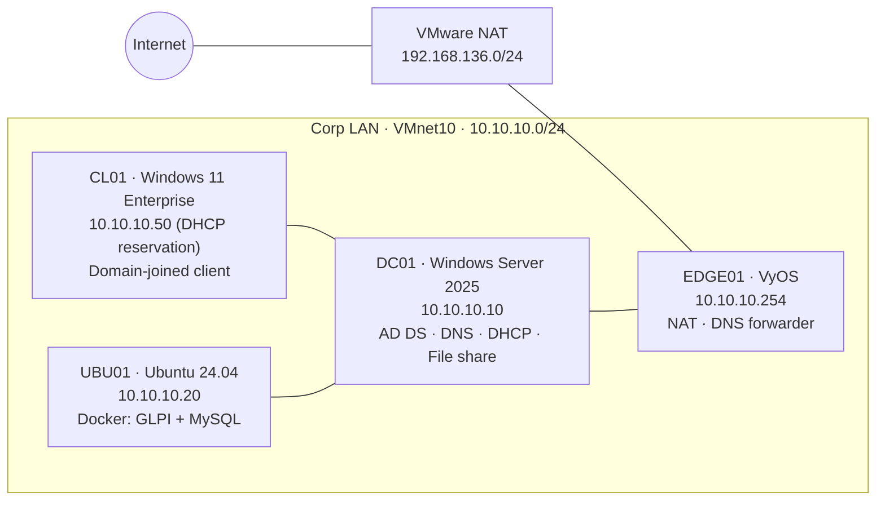

# AD Help Desk Lab

A simulated small-business IT environment for a fictional company, **Nebula**, built from scratch in VMware Workstation. It includes a Windows Server 2025 Active Directory domain with DNS, DHCP and Group Policy, PowerShell joiner/leaver automation, and **GLPI** ticketing on Docker.

I use it to work through realistic 1st/2nd-line support incidents end to end: **log the ticket → diagnose layer by layer → fix → verify → document a knowledge-base article**.

---

## Architecture

| Host | IP | Role |
|---|---|---|
| EDGE01 | 10.10.10.254 | VyOS router: LAN gateway, source NAT, DNS forwarding |
| DC01 | 10.10.10.10 | Domain controller `ad.nebula.internal` (NetBIOS `NEBULA`): AD DS, DNS, DHCP, `\\dc01\Finance` share |
| UBU01 | 10.10.10.20 | GLPI service desk (tickets, SLAs, approvals, asset inventory) on Docker Compose |
| CL01 | 10.10.10.50 | Windows 11 client, managed by Group Policy and inventoried by the GLPI Agent |

Full address plan: [`docs/ip-plan.md`](docs/ip-plan.md)

---

## What I built

| Area | Details | Build notes |
|---|---|---|
| **Routing / NAT** | VyOS edge router: source NAT, DNS forwarding, SSH on the LAN side only | [01](docs/build/01-edge01.md) |
| **Active Directory** | Forest/domain promotion, DNS (forward + reverse zones, forwarder), time service | [02](docs/build/02-dc01-prep.md) · [03](docs/build/03-dc01-promotion.md) |
| **DHCP** | Scope, options 3/6/15, reservation, AD authorisation | [04](docs/build/04-dc01-dhcp.md) |
| **Client** | Windows 11 domain join, RSAT | [05](docs/build/05-cl01-build.md) |
| **Service desk** | GLPI + MySQL on Docker Compose, ITIL categories, priority matrix, SLAs (TTO 30 min / TTR 8 h), approvals | [06](docs/build/06-ubu01-glpi-build.md) · [`glpi/`](glpi/) |
| **Asset inventory** | GLPI Agent on DC01 and CL01 | [07](docs/build/07-glpi-agent.md) |
| **AD design** | OU structure, **AGDLP** groups (`GG_*` → `DL_Share_*_RW`), NTFS + share permissions | [08](docs/build/08-ad-structure.md) |
| **Group Policy** | Password and lockout policy, targeted drive map, Control Panel restriction, Windows Update; tested with `gpresult` | [09](docs/build/09-group-policy.md) · [GPO backups](configs/gpo-backup/) |
| **Automation** | PowerShell joiner (CSV → 25 users), leaver (disable, scramble, strip groups, move OU) and stale-account report, all with `-WhatIf` | [10](docs/build/10-powershell-automation.md) · [`scripts/`](scripts/) |

---

## Incidents resolved

Each ticket was logged and worked in GLPI, and is written up as a knowledge-base article.

| KB | Incident | GLPI | Key skills |
|---|---|---|---|
| [01](kb/kb01-lab-dns-blocked-on-eduroam.md) | Lab has no external DNS on a restricted network | – | Layered troubleshooting, NAT, DNS forwarding, ICMP vs TCP testing |
| [02](kb/kb02-ubu01-clock-one-hour-fast.md) | Linux VM clock one hour fast | – | Hardware clock vs UTC, chrony, time sync for Kerberos |
| [03](kb/kb03-cl01-no-network-dhcp.md) | Client gets no IP address after boot | – | DHCP service start order, `ipconfig /renew` |
| [04](kb/kb04-dhcp-not-authorised-after-promotion.md) | DHCP not authorised after DC promotion | – | `dcdiag`, event IDs, DHCP authorisation |
| [05](kb/kb05-account-lockout.md) | User account locked out | #1 | Lockout policy, `Search-ADAccount`, event 4740 |
| [06](kb/kb06-password-reset.md) | Forgotten password | #2 | Identity verification, social-engineering awareness |
| [07](kb/kb07-share-access-denied.md) | Access denied to Finance share | #3 | Effective Access, AGDLP, event 4729, logon tokens, approval workflow |
| [08](kb/kb08-dhcp-scope-exhausted.md) | No network: APIPA, DHCP scope exhausted | #4 | DHCP audit log, scope statistics, DHCP starvation awareness, change control |

---

## Security practices in this repo

- **No secrets committed:** `.env` is git-ignored (only [`.env.example`](glpi/.env.example)), and script output with temporary passwords is excluded. Every commit is scanned with `gitleaks`.
- **Router config sanitised** with VyOS `show configuration commands | strip-private`.
- **Fake identities only:** all users in [`starters.csv`](scripts/starters.csv) are fictional.
- **Least privilege:** groups, not users, get permissions; Modify, not Full control; access changes need approval in GLPI.
- Lab-only trade-offs are recorded as decisions: [`docs/decisions/glpi-security.md`](docs/decisions/glpi-security.md).

---

## Lessons

- **Verify against the system, not the notes.** Test accounts that didn't exist or had been offboarded caused false results twice. The first check for any "can't log in" ticket is `Get-ADUser`.
- **Test as the affected user, from their machine.** `gpresult`, `whoami /groups` and port tests run from the admin's session or the server measure the wrong thing.
- **Group changes need a new logon token.** Fixing AD isn't the end: the user must sign out and back in.
- **Find out *why*, not just *what*.** Security event 4729 showed who removed a user from a group. It was the shared built-in Administrator, which is why named admin accounts matter.
- **Back up before changing a production service** (`Export-DhcpServer`, `Backup-GPO`), and record emergency changes in the ticket.

## Next

- [ ] Broken trust relationship (`Test-ComputerSecureChannel -Repair`)
- [ ] Kerberos time skew
- [ ] Named admin accounts, and retire use of the built-in Administrator
- [ ] Manual vs script timing for onboarding (3 users)

---

**Tools:** VMware Workstation · Windows Server 2025 · Windows 11 · Ubuntu 24.04 · VyOS · Docker Compose · GLPI · PowerShell · Git · gitleaks
